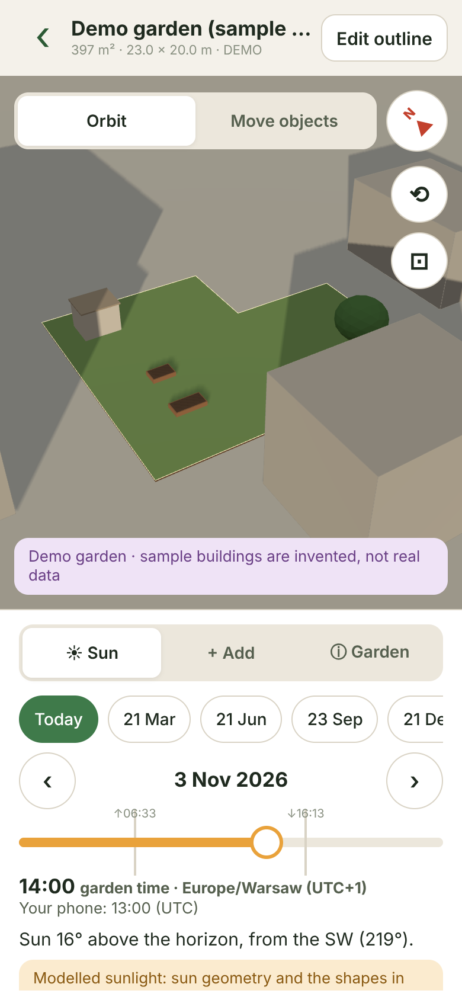

# Gardena: map a real garden, then explore it in 3D

An Expo (SDK 58) React Native prototype for iOS and Android. You find your
garden on aerial imagery, trace its outer boundary, and the outline becomes a
standalone 3D garden. In 3D you can add beds, trees and buildings, and see
modeled sun direction and shadows for any date and time.



## What works

| Step | Details |
|---|---|
| **Find your garden** | Search by address (Geoapify worldwide with a key; Poland's GUGiK address register without one). You can also type `lat, lon`, or use the phone's location. Loading, no-result and failure states are shown. |
| **Draw and confirm the boundary** | Switch explicitly between "Move map" and "Draw outline". The map is locked while drawing. Tap to add corners, tap the first corner or "Close shape" to close. Drag a corner to move it, drag a **+** to insert a corner. Undo and reset are available. The area updates as you draw. Self-intersections are shown in red and block confirmation. |
| **Saved record** | Original WGS84 coordinates, a fixed local origin, CCW-normalised ring, IANA time zone of the garden, area, perimeter, minimum bounding rectangle (length × width) and long-axis orientation. Stored on the device (AsyncStorage), one key per garden. |
| **Map → 3D transition** | The outline you drew glides from its map position onto a north-up plan view. It then extrudes into a grass/soil slab while the camera tilts to an isometric view. With the OS "Reduce motion" setting on, the app jumps straight to the final view. No imagery is captured or reused. |
| **Your 3D garden** | Drag to orbit, pinch to zoom, two fingers to pan. Tap the north indicator or ⟲ to reset, ⊡ for top-down. "Edit outline" goes back to top-down map editing. Objects and settings are kept. |
| **Objects** | Add a raised bed, a tree or a building. Move them in "Move objects" mode and edit height, size, rotation and canopy. Every height carries a source label (default / set by you / tagged / storeys / assumed / sample). |
| **Surroundings** | Optional: load OSM buildings within 80 m, including outside your boundary, as a separate context layer. Heights are labeled by source and editable. When loading fails, the app says so: "Shadows only include objects you add". |
| **Sun** | Date presets (today, equinoxes, solstices), day stepping and a time scrubber with sunrise and sunset marks. The sun is computed locally, and time is **garden time** with zone, offset and summer-time flag. The phone's own time is shown separately when it differs. Light and shadows update live, and the readout is labeled "modelled, not measured". |
| **Demo mode** | "Try the demo garden" opens a labeled sample garden with invented buildings. It needs no credentials or network and supports the whole flow: 3D, editing, persistence, sun and outline editing on a metric grid. |

Provider research, costs and licensing are in
[`docs/provider-research.md`](docs/provider-research.md).

## Chosen stack and why (short version)

- **Map renderer:** MapLibre React Native 11.5. Open-source renderer with no
  vendor billing. Needs a dev build.
- **Imagery:** GUGiK national orthophoto (Poland), released free of charge
  under Polish law. Mapbox and Google terms prohibit tracing their imagery
  commercially. MapTiler has no explicit tracing permission. Esri World Imagery
  is implemented but **off by default**, because its tracing grant is ambiguous
  for a non-ArcGIS app. Outside covered areas you draw on a metric grid.
- **Geocoding:** Geoapify, with a free commercial tier and storage allowed, plus
  GUGiK UUG for Poland. Search results only move the camera and are never
  stored.
- **Sun:** `suncalc` 2.1.1, local and free, plus `@photostructure/tz-lookup`
  and `Intl`. No paid API is needed.
- **3D:** three.js 0.166 drawn into an `expo-gl` context. This version matches
  the peer range of the maintained `expo-three`. No WebView.
- **Obstacles:** manual objects, plus optional OpenStreetMap via Overpass (the
  public endpoint is for development only).

**Estimated running cost:** $0/month at 100, 1,000 and 10,000 MAU for gardens in
Poland. The first things that would add cost:

- enabling Esri imagery: about $12 (1k MAU) to about $156 (10k MAU) per month
  on session billing;
- heavy type-ahead geocoding beyond Geoapify's 3,000 requests/day;
- moving OSM context to a self-hosted or pre-extracted service.

The research doc has the full arithmetic.

## Setup

Requirements:

- Node 20 or newer.
- For device builds: Android Studio with an emulator, or Xcode with a simulator,
  or an EAS account.

Install dependencies:

```bash
npm install
```

Create your local env file and fill in what you have. Everything is optional:

```bash
cp .env.example .env.local
```

### Credentials

| Variable | Needed for | Kind |
|---|---|---|
| `EXPO_PUBLIC_GEOAPIFY_API_KEY` | Address search outside Poland | Public client key. Restrict it in the Geoapify dashboard. |
| `EXPO_PUBLIC_ARCGIS_API_KEY` + `EXPO_PUBLIC_ENABLE_ESRI_IMAGERY=true` | Esri imagery outside Poland | Public, restricted key. **Enable only after Esri confirms the licence.** |
| `EXPO_PUBLIC_CUSTOM_IMAGERY_URL` (+ `_NAME`, `_ATTRIBUTION`) | Any other XYZ imagery you are licensed to use | No key needed |
| `EXPO_PUBLIC_OVERPASS_URL` | OSM building context | Self-hosted for production |

Every `EXPO_PUBLIC_*` value ends up inside the app bundle. Never put a server
secret there. No provider in this stack requires a secret or a proxy for the
prototype.

### Why a development build (not Expo Go)

MapLibre React Native is a native module that Expo Go does not include.
`expo-gl`, `expo-location` and `react-native-svg` would run in Expo Go, but the
map would not. Build a dev client once and then iterate with Metro as usual.

Local builds:

```bash
npx expo run:android
```

```bash
npx expo run:ios
```

Or build in the cloud with EAS (profiles are in `eas.json`):

```bash
npx eas-cli@latest build --profile development --platform android
```

```bash
npx eas-cli@latest build --profile development-simulator --platform ios
```

Then start Metro for the dev client:

```bash
npm start
```

For a quick look without native builds, the web target runs the whole app. The
map is replaced by the metric grid; the 3D view is the same three.js code:

```bash
npm run web
```

## Checks

Run type checking, ESLint (expo config with React 19 hook rules) and the
unit tests (vitest):

```bash
npm run check
```

Headless browser run of the real UI (needs Playwright with Chromium). It
writes screenshots to `tests/e2e/output/`:

```bash
npm run e2e:web
```

### What was tested in this build

- **Types and lint:** `tsc --noEmit` and ESLint are clean.
- **Unit tests (54):**
  - **Geometry:** L-shaped and star-shaped concave polygons (area, triangulation
    coverage, notch excluded). Invalid outlines: fewer than three distinct
    points, collinear, bow-tie, vertex touching an edge. Duplicate removal,
    winding normalisation, rotated-rectangle dimensions and bearing.
  - **Projection:** checked against WGS84 geodesics from pyproj (≤1 cm at
    10–200 m, four latitudes).
  - **Sun:** checked against NREL SPA (pvlib), with max error 0.007° altitude
    and 0.013° azimuth over 33 daytime cases on six locations and both
    hemispheres. Sunrise, sunset and noon within 2 minutes. Polar day and night.
  - **Time zones:** local→UTC matches Python `zoneinfo` for 36 cases. Also
    covered: DST gaps and overlaps (Warsaw, Sydney, New York), Kathmandu
    +5:45, and results that do not change with the device time zone
    (Los Angeles, Tokyo, UTC).
  - **Providers:** GUGiK EPSG:2180→WGS84 within 1 m of pyproj, Geoapify and
    GUGiK response mapping, fallback and error messages, imagery selection
    (Esri never enabled by a key alone). OSM height parsing and labeling, and
    failed/empty/HTTP-error obstacle loads.
  - **Persistence:** save → fresh repository → identical record. Rename, delete,
    and corrupt or future-schema records ignored. Outline edits keep origin,
    objects and sun.
  - **3D scene:** slab extent equals the polygon extent in metres, with north at
    −Z. Plan view has north up, and the isometric view rotates the compass.
    Framing contains the outline. Picking and the tap-to-ground mapping work.
    The sun light sits on the sun side and is off at night. Camera moves do not
    trigger a shadow recompute.
- **Headless Chromium (web build, SwiftShader WebGL2), all passing:**
  - The demo opens in 3D with shadows.
  - The time scrubber changes the sun readout (Dec: 11° SE → 7° SW) and the
    shadows.
  - Orbit, adding and resizing a tree, and dragging it all work.
  - Top-down view and info panel.
  - After a reload, the demo still has its 5 objects.
  - Drawing a concave L outline on the grid: undo, closing, a red
    self-intersection that blocks confirm, then undo. The resulting area is
    301 m², which matches an independent calculation from the click geometry.
  - The confirm transition was captured frame by frame.
  - "Edit outline" returns to top-down editing.
  - Reduced motion skips the animation.
  - Search failure and building-data failure messages.
  - Garden time against a phone in New York.
- **Native:** the Android and iOS Hermes bundles compile (`expo export`), and
  `expo prebuild` applies the MapLibre, location and build-properties plugins.

**Not tested here:**

- **No device or simulator.** This sandbox has no Android SDK, Xcode or KVM, so
  MapLibre rendering, the GUGiK tiles, expo-gl on a real GPU, native gestures
  and Hermes `Intl` time zones still need checking on a device.
- **No live provider calls.** The sandbox blocked GUGiK, Geoapify and Overpass,
  so the integrations were tested with recorded or synthetic responses.

## Project layout

```
index.ts                         Expo entry → src/App.tsx
src/
├── App.tsx                      providers (safe area, garden store) + router
├── navigation/AppRouter.tsx     state-based routes and screen transitions
├── features/                    one folder per user-facing feature
│   ├── home/                    garden list, demo entry
│   ├── find-garden/             search + draw the boundary
│   │   ├── components/          SearchBar, SearchResults, DrawingOverlay, DrawingToolbar
│   │   ├── hooks/               useBoundaryDraft (points, undo, validation), useAddressSearch
│   │   └── map/                 MapSurface: MapLibre (native) / metric grid (web, demo, no imagery)
│   └── garden-3d/               the 3D garden
│       ├── components/          SunPanel, AddObjectPanel, ObjectEditor, ContextBuildingEditor,
│       │                        GardenInfoPanel, CompassButton, OutlineMorph
│       └── scene/               GardenScene (three.js, testable in Node), camera rig, GL canvas + gestures
├── domain/                      pure TypeScript, no React or network
│   ├── garden/                  types, create/edit garden records, demo garden
│   ├── geometry/                local metric projection, polygon validation/stats/triangulation
│   └── sun/                     sun position (suncalc), garden-time zone handling
├── services/                    talks to the outside world; swappable
│   ├── imagery/                 imagery providers (GUGiK, Esri opt-in, custom)
│   ├── geocoding/               Geoapify, GUGiK UUG, fallback chain
│   ├── obstacles/               OpenStreetMap buildings via Overpass
│   └── storage/                 local persistence + React store
└── shared/                      ui/ (one component per file, theme), hooks/, config/env.ts
tests/
├── fixtures/                    independent reference data (NREL SPA, pyproj, zoneinfo)
└── e2e/                         headless browser flows for the web build (output/ is git-ignored)
scripts/reference-data/          Python scripts that generate tests/fixtures
docs/                            provider research, README images
```

Unit tests sit next to the code they test (`*.test.ts`). ESLint enforces the
layering: `src/domain` may not import React, Expo, `services`, `features` or
`shared`, and features may not import each other.

## Known limitations

- Sunlight is **modeled** from sun geometry and the modeled shapes only. It
  ignores weather, terrain, slope and anything not modeled. Tree canopies are
  rough ellipsoids, so their shadows are approximate. Nothing here says what
  will grow well.
- Terrain is flat. The ground reference height is informational.
- OSM building heights are often missing. Those buildings use an *assumed* 6 m,
  labeled and shown lighter. The public Overpass endpoint is not for production
  traffic.
- Outside Poland there is no imagery unless you enable Esri (after licence
  confirmation) or configure another licensed source.
- The map is kept north-up and unpitched so drawing, the overlay maths and the
  3D hand-off share one orientation.
- Daily direct-sun hours and exposure heatmaps are not implemented. The
  research doc says how to add them cheaply.
